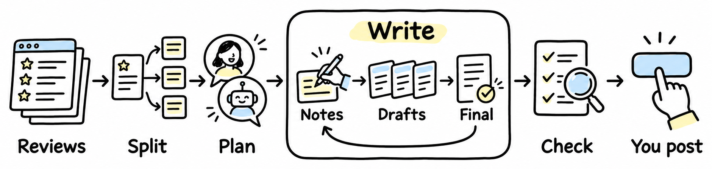

# Rebuttal Helper

A Claude Code skill that turns your reviews into OpenReview replies you can copy and post.



You jot a note on each point. The models you pick each write a draft. You write the final. It splits the finals into comments, checks them, and you post.

```bash
git clone https://github.com/JL10897/rebuttal-helper ~/.claude/skills/rebuttal-helper
```

Then tell Claude: "Help me write the rebuttal. The reviews are in reviews.html." · [More details](docs/details.md) · [中文](README_zh.md)
