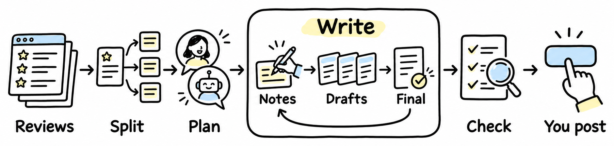

# Rebuttal Helper

一个帮你写 rebuttal 的 Claude Code skill。它不替你出主意：AI 对你论文的理解不够深，论证不好。它接手的是其余所有杂事，让你只需要想逻辑。



**你**：想好每一点怎么回，写几句笔记就行，什么语言都可以。

**它**：把审稿意见拆成点并附上审稿人原话；让你选的几个模型把笔记写成草稿，并排给你挑；笔记、草稿、定稿都放在一个页面里；把定稿整理成不超字数的 OpenReview comment；检查残留中文、占位符，以及和论文对不上的表格、附录编号。最后由你自己去发。

```bash
git clone https://github.com/JL10897/rebuttal-helper ~/.claude/skills/rebuttal-helper
```

然后跟 Claude 说：「帮我写 rebuttal，审稿意见在 reviews.html。」
